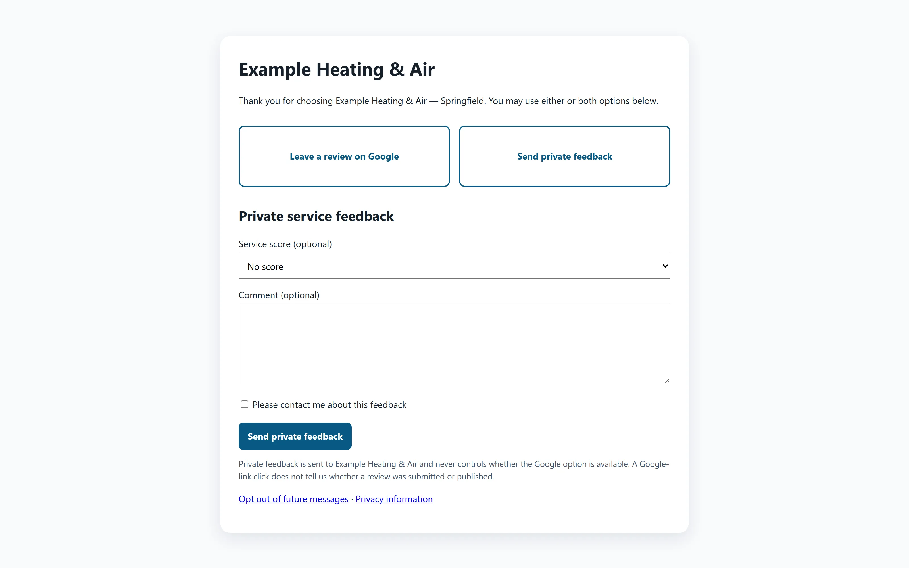
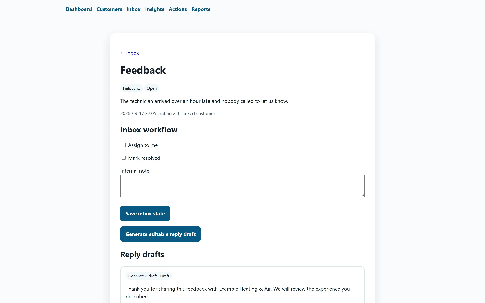
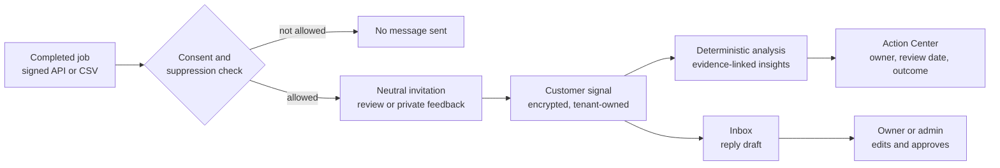

# Customer Feedback & Review Invitation Platform

**A consent-aware feedback and neutral review-invitation workflow for HVAC and local-service businesses.**

Status: **Pilot candidate**, verified locally with synthetic data only, with no customer pilot yet. Built by [Samir Mammadli](https://samir-mammadli.vercel.app).

> This is a **showcase repository**. It explains the product with screenshots, architecture and short code excerpts. The full source code is private and available on request for hiring or business conversations via [LinkedIn](https://www.linkedin.com/in/samirmammadli) or the [contact page](https://samir-mammadli.vercel.app/contact).

[Product page](https://samir-mammadli.vercel.app/products/customer-feedback-review-invitation-platform)

---

## The problem

Service businesses hear from customers in scattered places and rarely turn that feedback into fixes. Many review-request tools also quietly filter who gets asked for a review, a practice that review platforms prohibit.

## What it does


*Customers choose between a Google review and private feedback, and neither option is favoured.*

- Collects customer feedback natively and stores it as tenant-owned records, keeping the original text encrypted
- Requests reviews **neutrally**: it doesn't filter who gets asked, doesn't guess whether a review was posted, and doesn't monitor Google
- Deterministic local analysis (no external AI by default) surfaces recurring strengths and friction, with evidence links back to the source feedback
- An **Action Center** tracks each suggested improvement from hypothesis through owner, review date and measured outcome
- A unified inbox with assignment, resolution, encrypted internal notes and **human-approved reply drafts**
- An optional anonymous feedback path that stores no link to a customer or a job


*A generated reply always waits for a human to edit and approve it.*

## How it works



The cycle is **customer signal → insight → action → measurement → learning**. When there isn't enough data, the product says "Not enough data yet" instead of showing unsupported statistics.

## Design decisions

| Decision | Why |
|---|---|
| Neutral review requests | Every customer gets the same choice. Filtering out unhappy customers breaks review-platform rules and misleads future customers. |
| Tenant isolation in two layers | Database queries fail without a tenant context, and PostgreSQL row-level security blocks cross-tenant reads as a second boundary. |
| Consent is checked at send time | Consent history and audit events are append-only. A database constraint allows one invitation plus at most one reminder. |
| Customer text is untrusted | Feedback can't select tools, run commands, reach secrets or act as database instructions. |
| No external AI by default | The built-in analysis is deterministic and makes no network requests, so a probabilistic model needs a separate, approved evaluation first. |
| Humans approve every reply | A suggested reply is only an editable draft, and no auto-publishing is implemented. |

## Code excerpts

A reply can only be approved by an active owner or administrator, and only while it is still a draft:

```python
@transaction.atomic
def approve_reply_draft(draft: ReplyDraft, actor: User, edited_text: str) -> ReplyDraft:
    if not Membership.objects.filter(user=actor, is_active=True,
                                     role__in=[Membership.Role.OWNER, Membership.Role.ADMIN]).exists():
        raise PermissionError("Owner or administrator approval is required")
    if draft.status != ReplyDraft.Status.DRAFT:
        raise ValueError("Only a draft can be approved")
    if not edited_text.strip():
        raise ValueError("Approved reply cannot be empty")
    ...  # record approver, timestamp and approved status
```

Tenant scoping fails closed. Without a tenant context, a query raises an error instead of returning another tenant's data:

```python
def current_tenant_id() -> UUID:
    tenant_id = _tenant_id.get()
    if tenant_id is None:
        raise TenantContextMissing("Tenant context is required")
    return tenant_id

class TenantScopedManager(models.Manager):
    def get_queryset(self):
        return super().get_queryset().filter(tenant_id=current_tenant_id())
```

## Tech stack

Python · Django · PostgreSQL (forced row-level security) · Redis · Celery · Docker Compose · OpenAPI contract for signed job ingestion

Security: encrypted contacts and invitation tokens, keyed-HMAC deduplication, idempotent ingestion with replay rejection, Argon2, CSRF, CSP, HSTS, rate limits, and redacted structured logs.

## Verification and honest status

- **57 automated tests** across 10 files, including two end-to-end browser journeys.
- Google Business Profile and Meta connectors are sandbox fakes and interfaces only: no live OAuth, sync, webhooks or publishing.
- External AI processing is disabled by default.
- Legal and privacy templates are drafts that need professional legal review.

---

© 2026 Samir Mammadli. All rights reserved. See [LICENSE](LICENSE).
